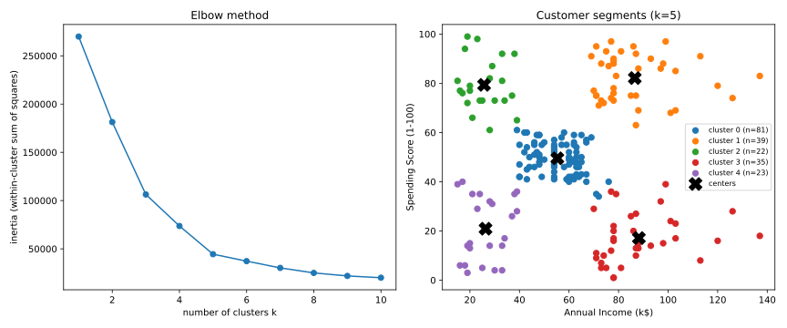

# Mall Customer Segmentation

A small practice project from my machine learning course. It groups mall
customers into segments using K-Means clustering on annual income and
spending score, and picks the number of clusters with the elbow method.

## Dataset

`Mall_Customers.csv`: 200 mall customers with age, gender, annual income
(k$) and spending score (1-100). A widely used public teaching dataset for
clustering. The CSV is included in this repo.

## How to run

```bash
pip install -r requirements.txt
python mall_segmentation.py
```

The script plots the elbow curve, fits K-Means with k=5, saves the plots
to `results.svg`, and prints the average profile of each segment.

## Results

The elbow method suggests k=5. The five segments it finds (averages):

| Cluster | Avg age | Avg income (k$) | Avg spending score | Interpretation        |
|---------|---------|-----------------|--------------------|-----------------------|
| 0       | 42.7    | 55.3            | 49.5               | average income/spend  |
| 1       | 32.7    | 86.5            | 82.1               | high income, high spend |
| 2       | 25.3    | 25.7            | 79.4               | low income, high spend  |
| 3       | 41.1    | 88.2            | 17.1               | high income, low spend  |
| 4       | 45.2    | 26.3            | 20.9               | low income, low spend   |



## Honest notes

- Learning exercise on a small public dataset, not a real customer study.
- Only income and spending score are used for clustering; age and gender
  are ignored by the model.
